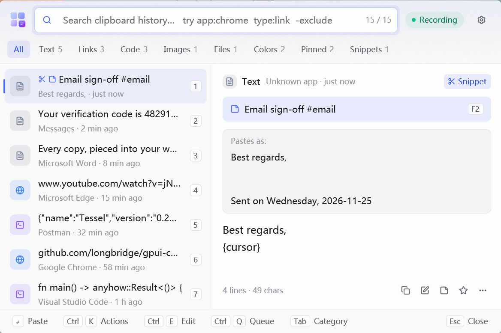
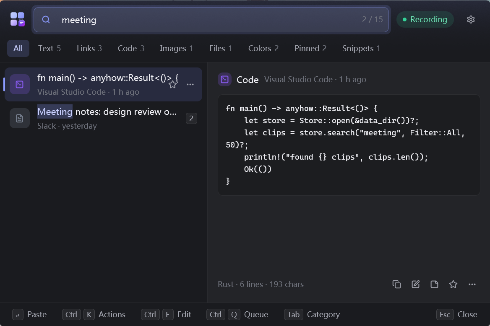
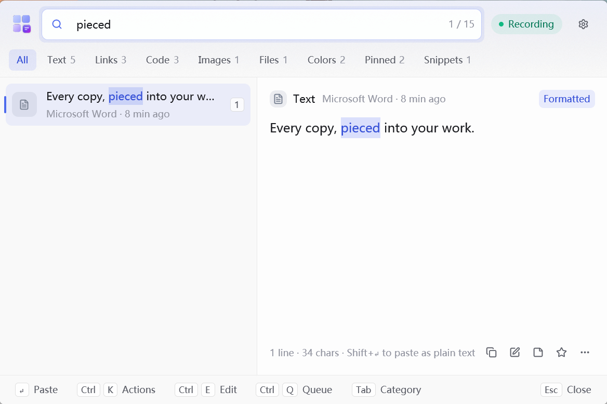
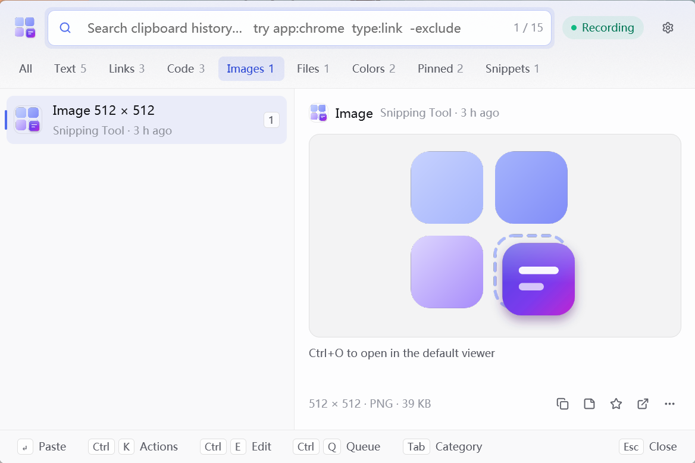
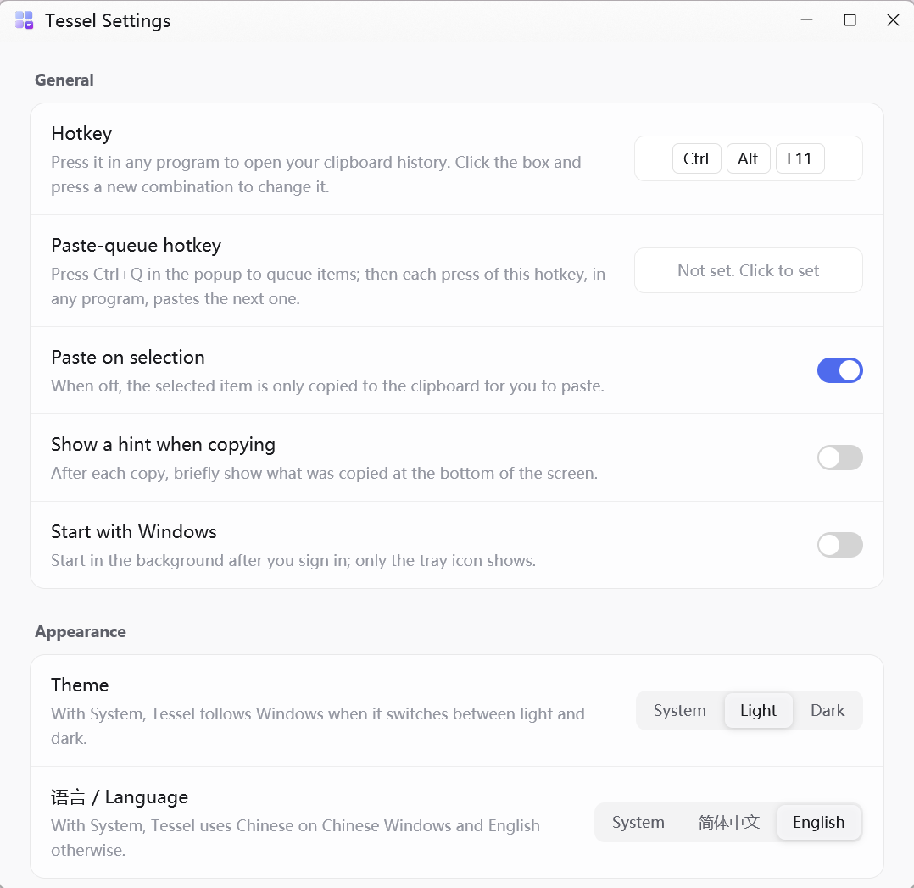

<p align="center">
  
</p>

<h1 align="center">Tessel</h1>

<p align="center"><b>An open-source clipboard manager for Windows</b></p>

<p align="center">Remembers the text, links, images and files you copy. Press <code>Alt+V</code> anywhere to search your clipboard history and paste it back.</p>

<p align="center"><b>English</b> · <a href="README.zh-CN.md">简体中文</a></p>

<p align="center">
  <a href="https://github.com/FarL1/tessel/actions/workflows/ci.yml"></a>
  
  <a href="https://github.com/FarL1/tessel/releases/latest"></a>
  
  
</p>

<p align="center">
  
</p>

> **Status**: v0.2.0 is the first public release. Sync across devices and mobile apps come later, see the [roadmap](#roadmap).

## What is Tessel?

Tessel is a **clipboard manager**. It quietly keeps a searchable **clipboard history** of everything you copy (`Ctrl+C`).
Whenever you need something again, press `Alt+V` in any app, type a few letters to find it, and press `Enter` to paste it where you were.

It takes care of small, everyday annoyances:

- The link you copied a minute ago got overwritten by the next copy, and you have to go find it again
- Filling in a form means switching back and forth between two windows, copying and pasting field by field
- The text you reuse all the time (an address, a reply template, a command) has to be dug up every time
- Text copied from a web page keeps its styling and messes up your document

If you're looking for any of these, Tessel is that kind of app:

- Clipboard history for Windows, a clipboard manager, a copy & paste tool
- A more capable replacement for the built-in `Win+V` clipboard history
- An alternative to Ditto or CopyQ
- Something like Paste, Maccy or Raycast's clipboard history on macOS, but on Windows

### How is it different from the built-in clipboard history (Win+V)?

| | Windows (`Win+V`) | Tessel |
|---|---|---|
| How much it keeps | The last 25 items | 5,000 by default, up to 100,000; pinned items are kept forever |
| After a restart | Cleared (except pinned items) | Everything is kept |
| Search | Basic filtering | Full-text search, text inside screenshots (OCR), filters by app and type, pinyin initials for Chinese text |
| Pasting | Pick an item to paste | `Enter` pastes into the previous window; `Ctrl+1–9` quick paste; a paste queue |
| Working with content | — | Format JSON, strip tracking parameters from links, convert colors, edit before pasting… |
| Where your data lives | On your PC (optional cloud sync) | Only on your PC, open source |

## Why Tessel

- **Truly lightweight**: drawn natively with [GPUI](https://www.gpui.rs/) (the GPU-accelerated UI framework behind the Zed editor). About **18 MB** of memory in the background, roughly a quarter of a comparable WebView app.
- **Fast**: shows up about 40 ms after the hotkey; searching thousands of items takes a few milliseconds; the list is virtualized, so it stays smooth however long your history gets.
- **Keyboard first**: open, search, pick and paste without touching the mouse. `Ctrl+1–9` quick paste, `Tab` to switch categories, `Ctrl+K` for the action menu.
- **Works with the mouse too**: right-click any item for the action menu, hover for quick buttons, double-click to paste.
- **Finds things**: full-text search, including the text inside images and screenshots (recognized offline with the OCR built into Windows); filter by source app or type; add notes and `#tags` to things you use often. For Chinese text, pinyin initials work too (`hyjy` finds "会议纪要").
- **Paste queue**: line up several clips, then press `Alt+Shift+V` in the target app to paste them one by one. Great for filling in forms.
- **Snippets and templates**: save text you reuse as snippets; dates, times and your last copy are filled in when you paste, and you can choose where the cursor ends up.
- **English / 中文**: the interface follows your Windows display language and can be switched in Settings.
- **You know the copy worked**: a small, unobtrusive hint at the bottom of the screen confirms each copy.
- **Knows what you copied**: recognizes links, colors, code (and its language), images and files, and previews each the right way.
- **Keeps formatting**: text copied from web pages, Word or Excel pastes back with its formatting; `Shift+Enter` pastes plain text.
- **Respects your privacy**: data stays on your PC; content that password managers mark as "do not record" is never read; you can exclude apps and pause recording at any time.

Where the name comes from: *tessellation*. Every copy is a tile, and together they form the trail of your work. The tile lifted out of the icon is the one you're about to paste.

## Screenshots

| Search highlighting · dark theme | Formatted text |
|---|---|
|  |  |
| **Image preview** | **Settings** |
|  |  |

## Install

Download `Tessel-Setup.exe` from the [latest release](https://github.com/FarL1/tessel/releases/latest) and run it. You can pick the install folder, and when it's done you choose whether to start Tessel now and whether it starts with Windows.

- Windows 10 / 11 (64-bit). Installs for the current user, **no administrator rights needed**
- Installs to `%LOCALAPPDATA%\Tessel.App` by default (or a folder you pick) and adds desktop and Start menu shortcuts
- To uninstall, use Settings → Apps (or `Uninstall Tessel.exe` in the install folder). This also turns off start-up with Windows. **Your history is kept** in `%LOCALAPPDATA%\Tessel` unless you tick "Also delete my clipboard history and settings"

> The installer isn't code-signed yet, so Windows may show "Windows protected your PC". Click "More info → Run anyway". Code signing is in progress.

Tessel checks GitHub once a day for a new version and tells you when one is out (tray menu → "Download Tessel x.y.z"). Updates aren't installed automatically yet: download the new installer and run it; your history is kept.

## Usage

Tessel lives in the system tray. Press **`Alt+V`** in any app to open it.

| Key | Action |
|---|---|
| Just type | Search (separate several words with spaces) |
| `↑` `↓` | Move the selection |
| `Enter` | Paste into the previous window (with formatting) |
| `Shift+Enter` | Paste as plain text |
| `Ctrl+1` … `Ctrl+9` | Paste item 1–9 directly (add `Shift` for plain text) |
| `Tab` / `Shift+Tab` | Switch category: All, Text, Links, Code, Images, Files, Colors, Pinned, Snippets |
| `Ctrl+P` | Pin / unpin (pinned items are never cleaned up automatically) |
| `Shift+Delete` | Delete the item |
| `Ctrl+O` | Open: links in the browser, files in File Explorer, images in the default viewer |
| `Ctrl+E` | Edit the text: `Ctrl+S` saves, `Ctrl+Enter` saves and pastes, `Esc` discards |
| `Ctrl+Q` | Add to / remove from the paste queue (see below) |
| `Ctrl+T` | Pin the popup on top (or click the pin): it stays open when you click elsewhere or paste, and pastes go to the window you used last |
| `Ctrl+N` | New snippet (see below) |
| `F2` | Add a note: give the item a name or group it with `#tags` (notes show in the list and are searchable) |
| `Ctrl+K` | Action menu: copy without pasting, format JSON, strip tracking parameters, convert colors, join lines… (only what applies to the item) |
| `Ctrl+,` | Settings |
| `Esc` | Close |

Add filters to a search and combine them freely with keywords:

| Filter | Meaning |
|---|---|
| `app:slack` | Only items copied from an app |
| `type:link` | Only one type: text / link / code / image / file / color |
| `is:pinned`, `is:rich`, `is:snippet` | Only pinned items / formatted text / snippets |
| `#work` (or `tag:work`) | Only items whose note has the `#work` tag |
| `-draft` | Leave out items containing "draft" |

For example: `invoice app:outlook -draft`.

**Paste queue**: to paste several pieces one after another (say, into a form), press `Ctrl+Q` on each of them in the popup
(their position in the queue shows on the right). Then go to the target app: each press of **`Alt+Shift+V`** pastes the next one,
and a hint at the bottom of the screen shows how many are left.

**Snippets and templates**: save text you reuse (reply templates, signatures, addresses, commands) as snippets. Press `Ctrl+N` to create one, or pick "Save as snippet" in the `Ctrl+K` menu.
Snippets are never cleaned up, live under the Snippets category, and their variables are filled in when you paste:

| Variable | Pastes as |
|---|---|
| `{date}` | 2026-11-24 |
| `{time}` | 14:05 |
| `{datetime}` | 2026-11-24 14:05 |
| `{weekday}` | Tuesday |
| `{clipboard}` | What you copied last |
| `{cursor}` | Where the cursor ends up after pasting |

For example, `Hi {cursor}, here is the report for {date}.` pastes with the cursor right after "Hi ". Only snippets are expanded; a `{date}` in ordinary history pastes as is.

**Text in images (OCR)**: text in images and screenshots you copy is recognized in the background with the OCR built into Windows (offline, nothing to download), so you can search for it. The image preview shows the text, and the `Ctrl+K` menu can paste it. Recognition uses your Windows display language; on Chinese Windows, English text in images is recognized less reliably.

**Copy hint**: after each copy, a small hint at the bottom of the screen shows what was copied and fades out after 1.5 seconds.
It never takes the focus away from what you're typing. You can turn it off in Settings.

**Mouse**: click to select, double-click to paste. Right-click any item (or the preview) for the action menu. Hover over a row for Pin and More buttons. The preview has buttons for copy, edit, note, pin and open; you can select part of its text and copy it with `Ctrl+C`. The key hints in the footer are clickable too.

Also: drag the empty space at the top to move the window (the position is remembered); click "● Recording" to pause recording; the tray menu has pause, start with Windows, settings, reset window position and clear history.

## Settings

Open them from the tray menu → "Settings…", the gear in the popup, or `Ctrl+,` in the popup.

The Settings window reads and writes `config.toml` in the data folder. You can also edit it in a text editor: **changes apply as soon as you save, and comments are kept**. If something is wrong, the previous settings stay in effect and the line with the error is reported.

| Key | Default | Description |
|---|---|---|
| `hotkey` | `"Alt+V"` | Hotkey to open Tessel, e.g. `"Ctrl+Shift+V"`, `"Win+Alt+V"`. If the new one is taken, the old one keeps working |
| `queue_hotkey` | `"Alt+Shift+V"` | Paste-queue hotkey: each press pastes the next queued item; `""` turns it off |
| `max_items` | `5000` | How many items to keep (pinned items don't count) |
| `auto_paste` | `true` | Paste on selection; `false` only copies to the clipboard |
| `copy_toast` | `true` | Show a hint at the bottom of the screen after each copy |
| `check_updates` | `true` | Check GitHub once a day for a new version |
| `language` | `"system"` | Interface language: `"system"` (follows Windows) / `"zh"` / `"en"` |
| `theme` | `"system"` | `"system"` / `"light"` / `"dark"` |
| `ignored_apps` | Common password managers | Never record copies from these programs (exe file name, case-insensitive) |

**Backups and new PCs**: Settings → Data → Export saves your history (images, formatting, notes and snippets included) to a single `.jsonl` file.
On the new PC, use Settings → Data → Import. Importing twice doesn't create duplicates; pins, snippets and notes are merged.
You can also export only pinned items and snippets to share your snippet library.

## Command line

Tessel ships with `tessel-cli.exe` (in `%LOCALAPPDATA%\Tessel.App\current\`) so scripts, launchers and AutoHotkey can use your clipboard history.
It reads and writes the same data directly, so Tessel doesn't need to be running.

```powershell
tessel-cli search meeting -n 5         # search with the same syntax as the popup (app: type: is: #tag -exclude)
tessel-cli search invoice --json       # JSON output for scripts
tessel-cli get 1                       # print the newest item in full
tessel-cli copy --snippet signature    # put the snippet whose note contains "signature" on the clipboard (variables filled in)
"Thanks for reaching out!" | tessel-cli add --snippet --note "reply #support"   # create a snippet
tessel-cli export backup.jsonl         # export (--kept: only pinned items and snippets); import to bring it back
tessel-cli show                        # open the popup of the running Tessel (also: settings)
tessel-cli paste-next                  # paste the next queued item into the active window
```

Most commands work on the data directly; `show`, `settings` and `paste-next` need Tessel to be running.

## Privacy

- Everything is stored only on your PC: `%LOCALAPPDATA%\Tessel\` (`tessel.db` + `images/` + `config.toml`). No account, no cloud, no telemetry.
- The only network request is the daily update check, which reads the public latest-release information from GitHub and sends nothing about you. Turn it off with `check_updates = false` or in Settings.
- Text recognition in images runs locally with the OCR built into Windows.
- Follows the Windows clipboard privacy conventions: content marked with `ExcludeClipboardContentFromMonitorProcessing` or `CanIncludeInClipboardHistory = 0` is **not even read**.
- Excluded apps are checked before the clipboard content is read.

## Performance

Measured for the M1 release (0.1.0 installer, laptop with an RTX 3070 Ti):

| Metric | Result |
|---|---|
| Memory in the background (private working set) | 18.2 MB |
| Hotkey → window on screen | 25–46 ms |
| Search in 3,000 items | about 3 ms |
| Paste (write clipboard → switch back → Ctrl+V) | about 50–70 ms |

Known issue: a cold start takes about 1.6–3 seconds, mostly GPUI's font checks and creating the D3D11 device (see the [M0 report](docs/m0-report.md), in Chinese). As a tray app it only starts once per sign-in, so this rarely matters.

## Roadmap

- [x] **M0 feasibility**: GPUI text input with Chinese IMEs, clipboard capture, hotkey-to-paste loop, search speed, memory
- [x] **M1 local Windows app**: capture, storage, search, rich text, settings, tray, start with Windows, installer
- [x] **M2 polish + first public release (v0.2.0)**: paste queue, action menu (`Ctrl+K`), snippets and templates, notes and tags, pinyin search, OCR, English UI, import/export, command line, update check
- [ ] Code signing; automatic installation of updates (waiting for Velopack 1.3 stable)
- [ ] **M3 sync across devices**: direct LAN connections, end-to-end encryption, no server needed (iroh)
- [ ] **M4 mobile**: Android keyboard, iOS keyboard and share extension
- [ ] **M5 macOS / Linux + plugins**

See the [project plan](docs/plan.md) (in Chinese) for details.

## Development

You need Windows, Rust (the version is pinned in `rust-toolchain.toml`, MSVC target) and Visual Studio 2022 or Build Tools with "Desktop development with C++".

```sh
cargo run -p tessel                                   # run (debug builds log to the console; TESSEL_DEBUG=1 for more)
cargo test --workspace                                # tests
cargo clippy --workspace --all-targets -- -D warnings # lints (same as CI)
cargo deny check                                      # dependency licenses and security advisories
cargo run -p icon-gen --release                       # regenerate PNG / ICO after editing assets/brand/*.svg
```

During development, use a separate data folder so you don't touch the Tessel you use every day or your real history (both can run at the same time):

```powershell
$env:TESSEL_DATA_DIR = "$env:TEMP\tessel-dev"
cargo run -p tessel-core --example seed --release -- $env:TESSEL_DATA_DIR --demo-en   # demo data (--demo for Chinese)
cargo run -p tessel
```

**Packaging**: run `dotnet tool install -g vpk --version 1.2.161` once, then `scripts\package.ps1`; the installer ends up in `dist\`. Pushing a `v*` tag makes CI build the installer and create a draft GitHub Release.

### Code layout

| Path | What's there |
|---|---|
| `crates/tessel-core` | Data model, content detection, config, SQLite storage and search. No UI or platform code, fully unit-tested |
| `crates/tessel-clipboard` | Platform clipboard: event-driven watching, reading that respects privacy flags, writing back by type (Windows for now) |
| `apps/tessel` | Desktop app (GPUI): popup, settings window, global hotkeys, tray, pasting |
| `apps/tessel-cli` | Command line tool: search, get, copy, add, import and export |
| `spikes/` | M0 feasibility prototypes, kept for reference |
| `tools/icon-gen` | Generates PNGs and the `.ico` from the SVG |
| `scripts/` | Packaging script |
| `docs/` | Research, project plan, M0 report, toolchain notes (in Chinese) |

### Tech stack

Rust 2024 · [GPUI](https://www.gpui.rs/) + gpui-kit (based on [gpui-component](https://github.com/longbridge/gpui-component)) · SQLite (FTS5 trigram) · [Velopack](https://velopack.io) (installer and updates) · GitHub Actions + cargo-deny. The reasoning is in [docs/research.md](docs/research.md) and [docs/toolchain.md](docs/toolchain.md) (in Chinese).

## License

Licensed under either of

- Apache License, Version 2.0 ([LICENSE-APACHE](LICENSE-APACHE))
- MIT License ([LICENSE-MIT](LICENSE-MIT))

at your option.

Unless you explicitly state otherwise, any contribution intentionally submitted for inclusion in this project by you, as defined in the Apache-2.0 license, shall be dual licensed as above, without any additional terms or conditions.
