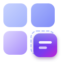
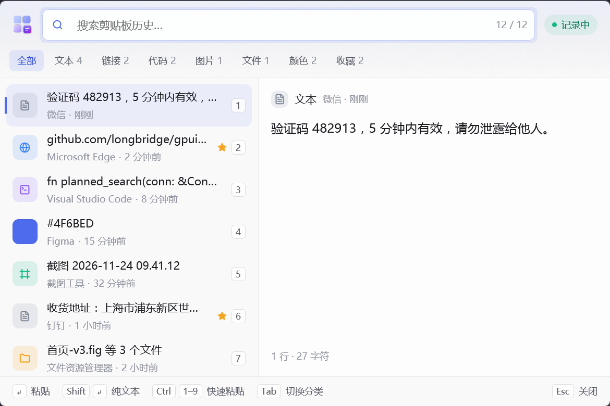

<p align="center">
  
</p>

<h1 align="center">Tessel · 拼贴</h1>

<p align="center"><b>每一次复制，都拼进你的工作里。</b></p>

<p align="center">原生、轻量、键盘优先的开源剪贴板工具，支持多设备端到端加密直连同步。</p>

<p align="center">
  
</p>

> 🚧 项目处于 **M0 技术验证**阶段，界面里的数据还是模拟数据，还不能日常使用。

## 为什么是 Tessel

- **真正轻量**：基于 GPUI（Zed 编辑器的 GPU 渲染 UI 框架），常驻内存约 **17–24MB**，大约是同等 WebView 方案的 1/4。
- **快**：按 `Alt+V` 到界面画出来约 40ms；10 万条历史中搜索的中位数耗时 0.27ms。
- **键盘优先**：唤起、搜索、选择、粘贴都不用碰鼠标；`Ctrl+1–9` 快速粘贴，`Tab` 切换分类。
- **尊重隐私**：本地优先；遵守密码管理器等应用设置的系统隐私标记，命中时连内容都不读。
- **多设备同步**（规划中）：局域网直连，端到端加密，不需要服务器。

名字的由来：Tessel 源自 *tessellation*（镶嵌）。每一次复制都是一块瓷砖，拼起来就是你的工作轨迹。图标里那块被取出来的瓷砖，就是你正要粘贴的那一条。

## 文档

- 调研报告：[docs/research.md](docs/research.md)
- 项目方案与路线图：[docs/plan.md](docs/plan.md)
- M0 技术验证记录：[docs/m0-report.md](docs/m0-report.md)

## 开发环境（Windows）

- Rust 工具链由 `rust-toolchain.toml` 锁定，需要 **MSVC** 目标（`x86_64-pc-windows-msvc`）
- Visual Studio 2022（或 Build Tools），勾选"使用 C++ 的桌面开发"，并安装 Windows SDK

```sh
cargo run -p spike-popup-paste             # 运行原型（可执行文件名为 tessel）
cargo run -p icon-gen --release            # 修改 assets/brand/*.svg 后重新生成 PNG / ICO
```

## 许可证

可任选以下两种协议之一：

- Apache License 2.0（[LICENSE-APACHE](LICENSE-APACHE)）
- MIT License（[LICENSE-MIT](LICENSE-MIT)）

除非你明确声明，否则你有意提交并纳入本项目的任何贡献，都将按上述双协议授权，不附加任何额外条款或条件。
