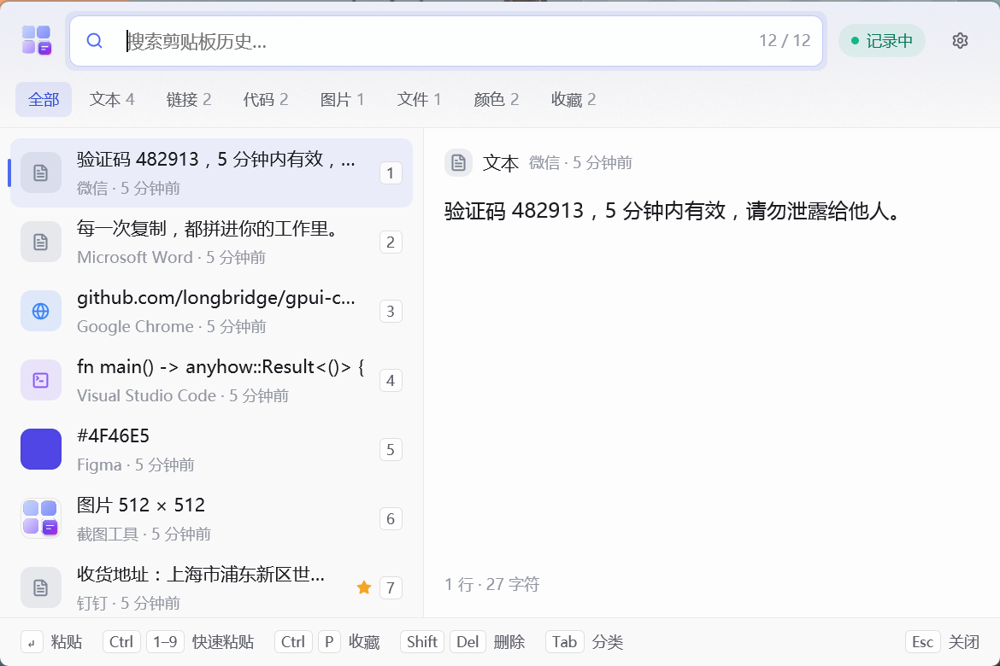
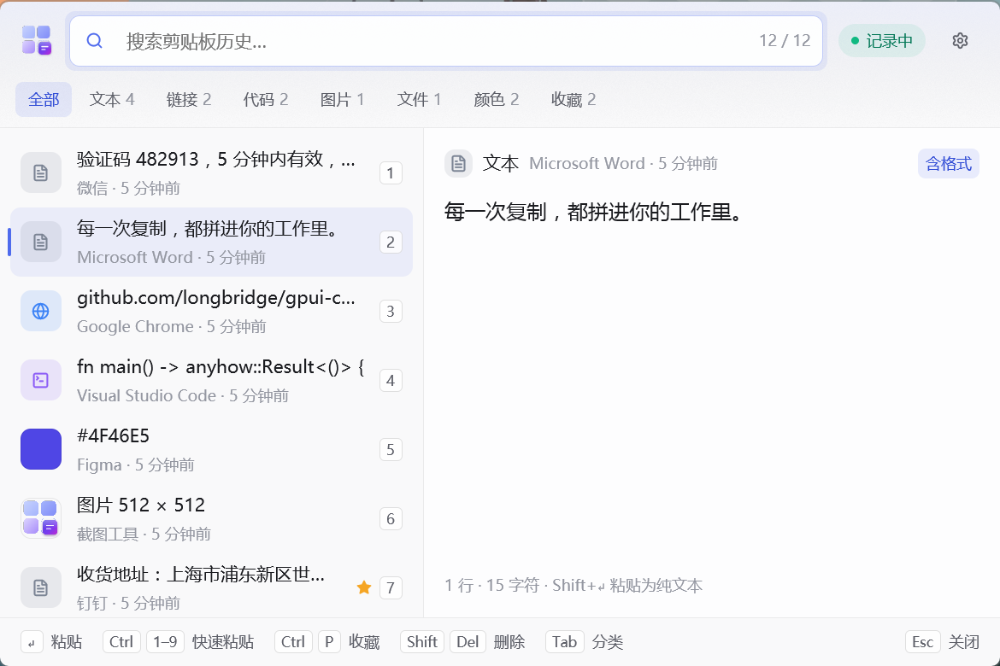
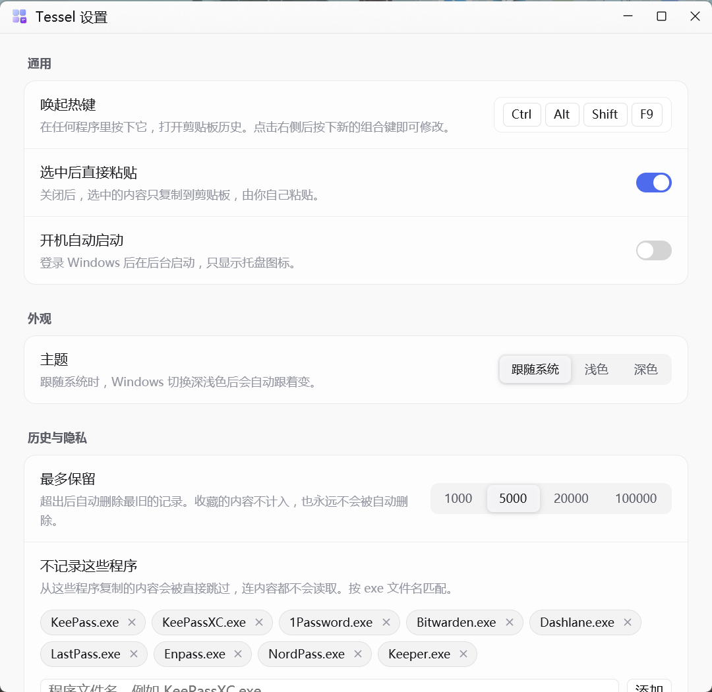

<p align="center">
  
</p>

<h1 align="center">Tessel · 拼贴</h1>

<p align="center"><b>每一次复制，都拼进你的工作里。</b></p>

<p align="center">原生、轻量、键盘优先的开源剪贴板工具。</p>

<p align="center">
  
  
  
  
</p>

<p align="center">
  
</p>

> **状态**：M1（Windows 本地版）已完成，日常可用。多设备同步、移动端在后续里程碑中，见[路线图](#路线图)。

## 为什么是 Tessel

- **真正轻量**：基于 [GPUI](https://www.gpui.rs/)（Zed 编辑器的 GPU 渲染 UI 框架）原生绘制，后台常驻内存约 **18MB**，大约是同等 WebView 方案的 1/4。
- **快**：按下热键约 40ms 出现；几千条历史里搜索只要几毫秒；列表是虚拟列表，历史再多也流畅。
- **键盘优先**：唤起、搜索、选择、粘贴都不用碰鼠标，`Ctrl+1–9` 快速粘贴，`Tab` 切换分类。
- **认得你复制的是什么**：自动识别链接、颜色、代码（并猜出语言）、图片、文件，按类型给出合适的预览。
- **格式不丢**：从网页、Word、Excel 复制的内容，粘贴回去仍带格式；`Shift+Enter` 粘贴为纯文本。
- **尊重隐私**：数据只存在本机；密码管理器等标记为"不要记录"的内容一律不读；可以指定不记录的程序、随时暂停。

名字的由来：Tessel 源自 *tessellation*（镶嵌）。每一次复制都是一块瓷砖，拼起来就是你的工作轨迹；图标里被取出来的那块，就是你正要粘贴的那一条。

## 截图

| 搜索高亮 · 深色主题 | 保留格式的文本 |
|---|---|
|  |  |
| **图片预览** | **设置** |
|  |  |

## 安装

下载 `Tessel.App-win-Setup.exe` 并运行即可：

- 支持 Windows 10 / 11（64 位），按当前用户安装，**不需要管理员权限**
- 安装到 `%LOCALAPPDATA%\Tessel.App`，创建桌面和开始菜单快捷方式
- 卸载：在"设置 → 应用"里卸载。会一并关闭开机自启；**历史数据会保留**在 `%LOCALAPPDATA%\Tessel`，不需要可以手动删除

> 安装包目前没有代码签名，Windows 可能提示"已保护你的电脑"，点"更多信息 → 仍要运行"。签名会在首个公开版本前解决。

## 使用

安装后 Tessel 常驻托盘，在任何程序里按 **`Alt+V`** 唤起。

| 按键 | 作用 |
|---|---|
| 直接输入 | 搜索（空格分隔多个关键词；中文两个字也能搜） |
| `↑` `↓` | 选择 |
| `Enter` | 粘贴到之前的窗口（保留格式） |
| `Shift+Enter` | 粘贴为纯文本 |
| `Ctrl+1` … `Ctrl+9` | 快速粘贴第 1–9 条（加 `Shift` 为纯文本） |
| `Tab` / `Shift+Tab` | 切换分类：全部、文本、链接、代码、图片、文件、颜色、收藏 |
| `Ctrl+P` | 收藏 / 取消收藏（收藏的内容永远不会被自动清理） |
| `Shift+Delete` | 删除这一条 |
| `Ctrl+O` | 打开：链接用浏览器、文件在资源管理器中定位、图片用系统查看器 |
| `Ctrl+K` | 动作菜单：只复制不粘贴、格式化 JSON、去掉链接追踪参数、转换颜色格式、合并为一行……（只列出对这一条有用的） |
| `Ctrl+,` | 打开设置 |
| `Esc` | 关闭 |

搜索时可以加过滤条件，和关键词任意组合：

| 写法 | 含义 |
|---|---|
| `app:微信`（或 `来源:微信`） | 只看某个程序复制的 |
| `type:link`（或 `类型:链接`） | 只看某种类型：text / link / code / image / file / color |
| `is:pinned`（或 `is:收藏`）、`is:rich` | 只看收藏的 / 带格式的 |
| `-草稿` | 排除包含"草稿"的 |

例如 `报销 app:飞书 -草稿`。

其他：拖动顶部空白处可以移动窗口（位置会记住）；点击"● 记录中"可以暂停记录；托盘菜单里有暂停记录、开机自启、设置、重置窗口位置、清空历史。

## 设置

打开方式：托盘菜单 →"设置…"、弹窗右上角的齿轮，或者在弹窗里按 `Ctrl+,`。

设置窗口读写的就是数据目录里的 `config.toml`，也可以直接用文本编辑器修改，**保存后立即生效，注释会保留**。写错时会保留之前的设置，并提示出错的行号。

| 项 | 默认值 | 说明 |
|---|---|---|
| `hotkey` | `"Alt+V"` | 唤起热键，如 `"Ctrl+Shift+V"`、`"Win+Alt+V"`。新热键被占用时继续使用旧热键 |
| `max_items` | `5000` | 最多保留的历史条数（收藏不计入） |
| `auto_paste` | `true` | 选中后直接粘贴；`false` 则只复制到剪贴板 |
| `theme` | `"system"` | `"system"`（跟随系统）/ `"light"` / `"dark"` |
| `ignored_apps` | 常见密码管理器 | 不记录这些程序复制的内容（按 exe 文件名，不区分大小写） |

## 隐私

- 所有数据只保存在本机：`%LOCALAPPDATA%\Tessel\`（`tessel.db` + `images/` + `config.toml`）。没有账号、没有云端、没有统计上报。
- 遵守 Windows 的剪贴板隐私约定：带 `ExcludeClipboardContentFromMonitorProcessing` 或 `CanIncludeInClipboardHistory = 0` 标记的内容，**连读都不读**。
- "不记录的程序"在读取剪贴板内容之前判断。

## 性能

在 M1 验收时测得（0.1.0 安装版，RTX 3070 Ti 笔记本）：

| 指标 | 结果 |
|---|---|
| 后台常驻内存（私有工作集） | 18.2 MB |
| 按下热键 → 界面出现 | 25–46 ms |
| 3000 条历史中查询 | 约 3 ms |
| 粘贴（写剪贴板 → 切回原窗口 → Ctrl+V） | 约 50–70 ms |

已知问题：冷启动约 1.6–3 秒，主要花在 GPUI 启动时的字体检查和 D3D11 设备创建上，详见 [M0 技术验证报告](docs/m0-report.md)。常驻托盘的工具只在开机时启动一次，影响不大。

## 路线图

- [x] **M0 技术验证**：GPUI 中文输入、剪贴板采集、热键与粘贴闭环、搜索性能、内存
- [x] **M1 Windows 本地版**：采集、存储、搜索、富文本、设置、托盘、开机自启、安装包
- [ ] **M2 体验打磨 + 首个公开版本**：粘贴队列、动作菜单（`Ctrl+K`）、片段与模板、OCR、自动更新、代码签名
- [ ] **M3 多设备同步**：局域网直连、端到端加密、不需要服务器（iroh）
- [ ] **M4 移动端**：Android 输入法、iOS 键盘与分享扩展
- [ ] **M5 macOS / Linux + 插件**

详见 [项目方案与路线图](docs/plan.md)。

## 开发

需要 Windows、Rust（版本由 `rust-toolchain.toml` 锁定，MSVC 目标），以及 Visual Studio 2022 或 Build Tools（勾选"使用 C++ 的桌面开发"）。

```sh
cargo run -p tessel                                   # 运行（调试版带控制台日志；TESSEL_DEBUG=1 输出更详细的日志）
cargo test --workspace                                # 测试
cargo clippy --workspace --all-targets -- -D warnings # 代码检查（CI 同款）
cargo deny check                                      # 依赖的许可证与安全公告检查
cargo run -p icon-gen --release                       # 修改 assets/brand/*.svg 后重新生成 PNG / ICO
```

开发时建议用独立的数据目录，不会碰到你正在使用的 Tessel 和真实历史（两者可以同时运行）：

```powershell
$env:TESSEL_DATA_DIR = "$env:TEMP\tessel-dev"
cargo run -p tessel-core --example seed --release -- $env:TESSEL_DATA_DIR --demo   # 写入一组演示数据
cargo run -p tessel
```

**打包**：先 `dotnet tool install -g vpk --version 1.2.161`，再运行 `scripts\package.ps1`，产物在 `dist\`。推送 `v*` 标签时 CI 会自动打包并创建 GitHub Release 草稿。

### 代码结构

| 目录 | 内容 |
|---|---|
| `crates/tessel-core` | 数据模型、内容识别、配置、SQLite 存储与搜索。不依赖 UI 和平台，可以单测 |
| `crates/tessel-clipboard` | 平台剪贴板：事件驱动监听、遵守隐私标记的读取、按类型写回（目前是 Windows） |
| `apps/tessel` | 桌面应用（GPUI）：弹窗、设置窗口、全局热键、托盘、粘贴 |
| `spikes/` | M0 技术验证程序，保留作参考 |
| `tools/icon-gen` | 从 SVG 生成各尺寸 PNG 和 `.ico` |
| `scripts/` | 打包脚本 |
| `docs/` | 调研报告、项目方案、M0 报告、工具链说明 |

### 技术栈

Rust 2024 · [GPUI](https://www.gpui.rs/) + gpui-kit（基于 [gpui-component](https://github.com/longbridge/gpui-component)） · SQLite（FTS5 trigram）· [Velopack](https://velopack.io)（安装与更新）· GitHub Actions + cargo-deny。选型理由见 [docs/research.md](docs/research.md)，工具链评估见 [docs/toolchain.md](docs/toolchain.md)。

## 许可证

可任选以下两种协议之一：

- Apache License 2.0（[LICENSE-APACHE](LICENSE-APACHE)）
- MIT License（[LICENSE-MIT](LICENSE-MIT)）

除非你明确声明，否则你有意提交并纳入本项目的任何贡献，都将按上述双协议授权，不附加任何额外条款或条件。
