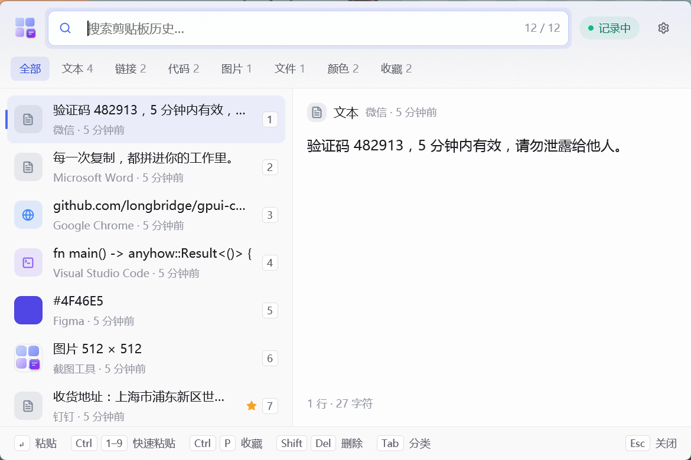
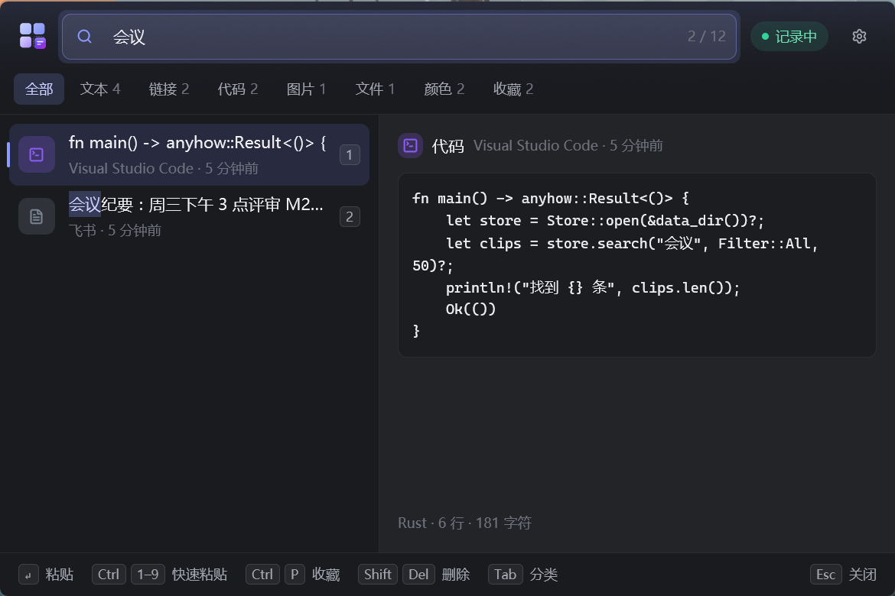
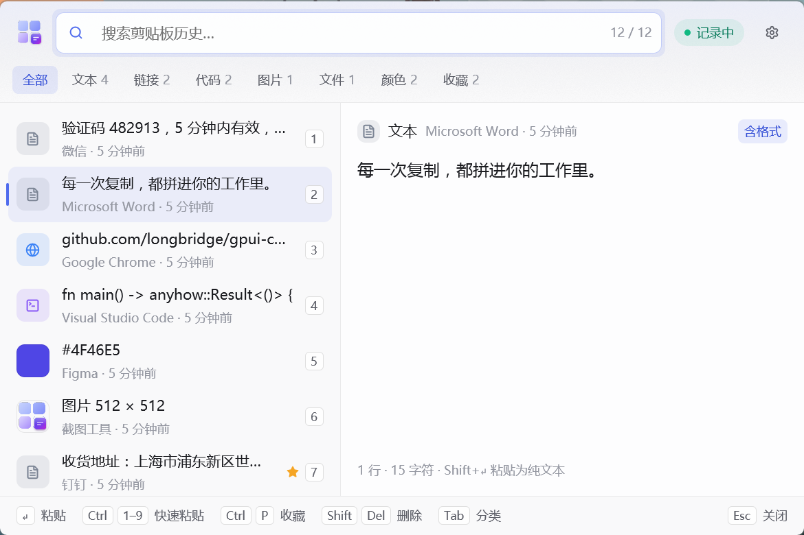
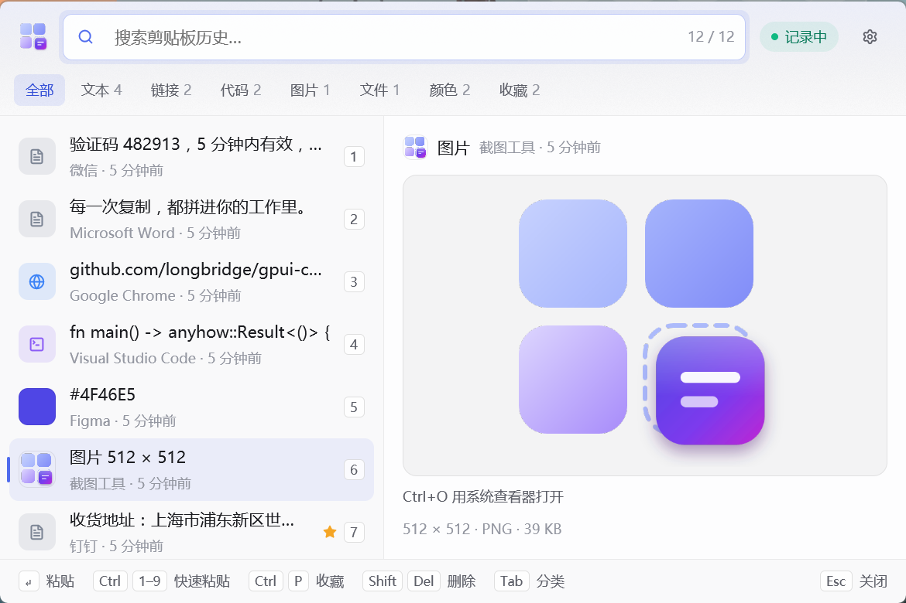
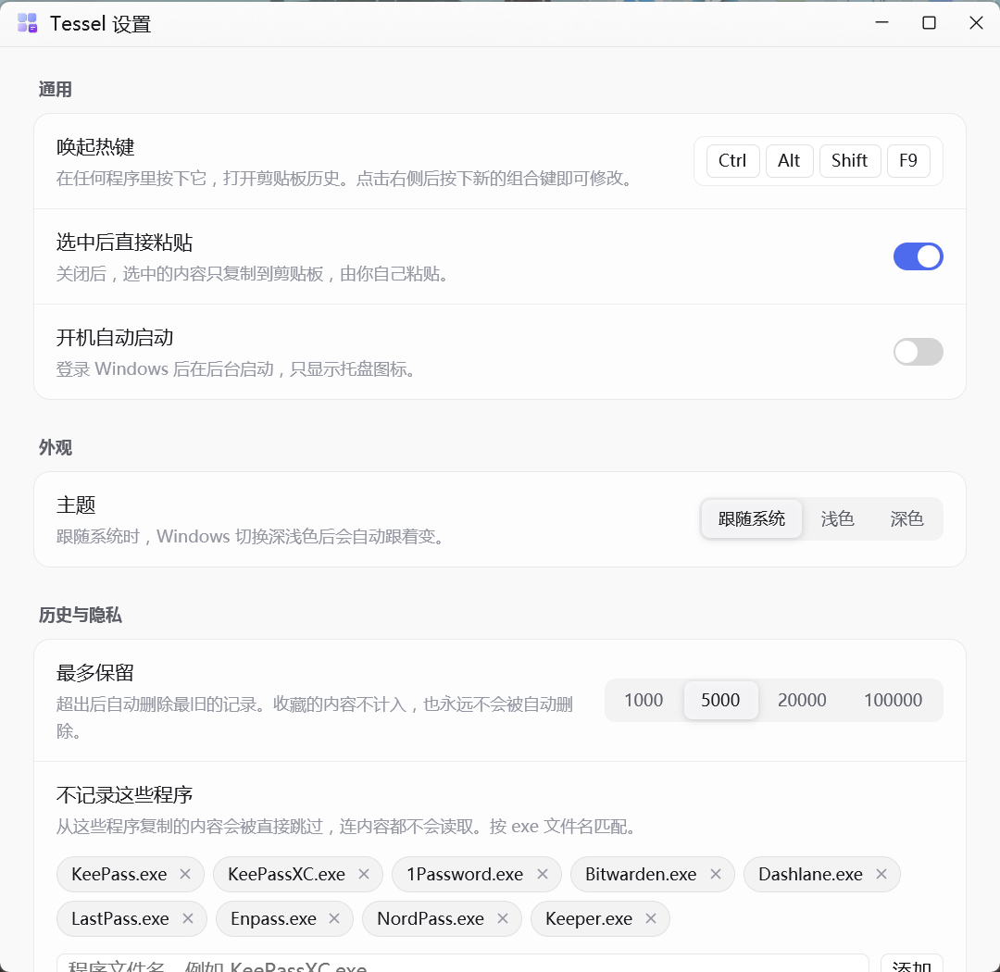

<p align="center">
  
</p>

<h1 align="center">Tessel · 拼贴</h1>

<p align="center"><b>开源的 Windows 剪贴板管理器（剪贴板历史工具）</b></p>

<p align="center">自动记住你复制过的文字、链接、图片和文件；按 <code>Alt+V</code> 随时搜索，一键粘贴回去。</p>

<p align="center"><a href="README.md">English</a> · <b>简体中文</b></p>

<p align="center">
  <a href="https://github.com/FarL1/tessel/actions/workflows/ci.yml"></a>
  
  <a href="https://github.com/FarL1/tessel/releases/latest"></a>
  
  
</p>

<p align="center">
  
</p>

> **状态**：v0.2.0 是首个公开版本。多设备同步、移动端在后续里程碑中，见[路线图](#路线图)。

## Tessel 是什么

Tessel 是一个**剪贴板管理器**：它在后台记下你每一次复制（`Ctrl+C`）的内容，形成一份可以搜索的**剪贴板历史**。
之后不管过了多久，在任何程序里按 `Alt+V`，输入几个字找到那一条，按回车就粘贴到原来的位置。

它解决的是这些日常的小麻烦：

- 刚才复制的链接被新复制的内容覆盖了，只能回去再找一遍
- 填表、整理资料时，要在两个窗口之间来回切换、复制、粘贴很多次
- 一段常用的文字（地址、模板回复、命令）每次都要重新找
- 从网页复制的内容带着格式，粘贴进文档里乱了样式

如果你在找下面这些东西，Tessel 就是这一类软件：

- Windows 剪贴板历史、剪贴板增强工具、复制粘贴工具
- 比 Windows 自带的 `Win+V` 剪贴板更强的替代品
- Ditto、CopyQ 之类剪贴板软件的替代
- macOS 上 Paste、Maccy、Raycast 剪贴板历史那样的工具，但是在 Windows 上

### 和 Windows 自带的剪贴板历史（Win+V）有什么不同

| | Windows 自带（`Win+V`） | Tessel |
|---|---|---|
| 保存多少条 | 最近 25 条 | 默认 5000 条，可调到 10 万条；收藏的永久保留 |
| 重启电脑后 | 清空（固定的除外） | 全部保留 |
| 搜索 | 简单过滤 | 全文搜索、拼音首字母、图片里的文字（OCR）、按来源程序 / 类型过滤 |
| 粘贴 | 选中后粘贴 | 回车直接粘贴回原窗口；`Ctrl+1–9` 快速粘贴；粘贴队列依次粘贴 |
| 处理内容 | — | 格式化 JSON、去掉链接追踪参数、转换颜色格式、编辑后再粘贴…… |
| 数据在哪 | 本机（可选云同步） | 只在本机，开源可查 |

## 为什么是 Tessel

- **真正轻量**：基于 [GPUI](https://www.gpui.rs/)（Zed 编辑器的 GPU 渲染 UI 框架）原生绘制，后台常驻内存约 **18MB**，大约是同等 WebView 方案的 1/4。
- **快**：按下热键约 40ms 出现；几千条历史里搜索只要几毫秒；列表是虚拟列表，历史再多也流畅。
- **键盘优先**：唤起、搜索、选择、粘贴都不用碰鼠标，`Ctrl+1–9` 快速粘贴，`Tab` 切换分类，`Ctrl+K` 打开动作菜单。
- **找得到**：全文搜索，中文两个字也能搜；支持拼音首字母（`hyjy` 找到"会议纪要"）；截图、图片里的文字也能搜（用 Windows 自带的 OCR 离线识别）；可以按来源程序、类型过滤；给常用的内容加备注和 `#标签`。
- **粘贴队列**：先把几段内容排好队，再在目标程序里每按一次 `Alt+Shift+V` 粘贴一条，填表、搬资料不用来回切窗口。
- **片段和模板**：常用的文字存成片段，粘贴时自动填入日期、时间、上一次复制的内容，还能指定粘贴后光标停在哪。
- **中文 / English**：界面可以在设置里切换成英文，默认跟随系统。
- **复制有回应**：每次复制成功，屏幕底部会轻轻提示一下复制了什么，不打断输入。
- **认得你复制的是什么**：自动识别链接、颜色、代码（并猜出语言）、图片、文件，按类型给出合适的预览。
- **格式不丢**：从网页、Word、Excel 复制的内容，粘贴回去仍带格式；`Shift+Enter` 粘贴为纯文本。
- **尊重隐私**：数据只存在本机；密码管理器等标记为"不要记录"的内容一律不读；可以指定不记录的程序、随时暂停。

名字的由来：Tessel 源自 *tessellation*（镶嵌）。每一次复制都是一块瓷砖，拼起来就是你的工作轨迹；图标里被取出来的那块，就是你正要粘贴的那一条。

## 截图

| 搜索高亮 · 深色主题 | 保留格式的文本 |
|---|---|
|  |  |
| **图片预览** | **设置** |
|  |  |

## 安装

从 [最新版本](https://github.com/FarL1/tessel/releases/latest) 下载 `Tessel-Setup.exe` 并运行。可以选择安装位置，装好后由你选择是否马上启动、是否开机自启：

- 支持 Windows 10 / 11（64 位），按当前用户安装，**不需要管理员权限**
- 默认安装到 `%LOCALAPPDATA%\Tessel.App`（也可以自选文件夹），创建桌面和开始菜单快捷方式
- 卸载：在"设置 → 应用"里卸载（或运行安装目录里的 `Uninstall Tessel.exe`），会一并关闭开机自启。**历史数据默认保留**在 `%LOCALAPPDATA%\Tessel`，卸载时勾选"同时删除剪贴板历史和设置"可以一起删掉

> 安装包目前没有代码签名，Windows 可能提示"已保护你的电脑"，点"更多信息 → 仍要运行"。代码签名正在申请中。

Tessel 每天检查一次 GitHub 上有没有新版本，有的话会提示你（托盘菜单 →"下载新版本"）。目前还不会自动安装：下载新的安装包运行即可，历史数据会保留。

## 使用

安装后 Tessel 常驻托盘，在任何程序里按 **`Alt+V`** 唤起。

| 按键 | 作用 |
|---|---|
| 直接输入 | 搜索（空格分隔多个关键词；中文两个字也能搜；支持拼音，`hyjy` 或 `huiyi` 都能找到"会议纪要"） |
| `↑` `↓` | 选择 |
| `Enter` | 粘贴到之前的窗口（保留格式） |
| `Shift+Enter` | 粘贴为纯文本 |
| `Ctrl+1` … `Ctrl+9` | 快速粘贴第 1–9 条（加 `Shift` 为纯文本） |
| `Tab` / `Shift+Tab` | 切换分类：全部、文本、链接、代码、图片、文件、颜色、收藏 |
| `Ctrl+P` | 收藏 / 取消收藏（收藏的内容永远不会被自动清理） |
| `Shift+Delete` | 删除这一条 |
| `Ctrl+O` | 打开：链接用浏览器、文件在资源管理器中定位、图片用系统查看器 |
| `Ctrl+E` | 编辑这一条的文字：`Ctrl+S` 保存，`Ctrl+Enter` 保存并粘贴，`Esc` 放弃 |
| `Ctrl+Q` | 加入 / 移出粘贴队列（见下） |
| `Ctrl+T` | 钉在前台（也可以点右上角的图钉）：点击别处、粘贴之后都不收起，粘贴到你最近在用的窗口 |
| `Ctrl+N` | 新建片段（见下） |
| `F2` | 写备注：给这一条起个名字，或者用 `#标签` 分类（列表里显示备注，搜索时也会搜备注） |
| `Ctrl+K` | 动作菜单：只复制不粘贴、格式化 JSON、去掉链接追踪参数、转换颜色格式、合并为一行……（只列出对这一条有用的） |
| `Ctrl+,` | 打开设置 |
| `Esc` | 关闭 |

搜索时可以加过滤条件，和关键词任意组合：

| 写法 | 含义 |
|---|---|
| `app:微信`（或 `来源:微信`） | 只看某个程序复制的 |
| `type:link`（或 `类型:链接`） | 只看某种类型：text / link / code / image / file / color |
| `is:pinned`（或 `is:收藏`）、`is:rich`、`is:snippet`（或 `is:片段`） | 只看收藏的 / 带格式的 / 片段 |
| `#常用`（或 `tag:常用`） | 只看备注里带 `#常用` 标签的 |
| `-草稿` | 排除包含"草稿"的 |

例如 `报销 app:飞书 -草稿`。

**粘贴队列**：要把几段内容依次粘贴到别处（比如填表）时，先在弹窗里对它们逐条按 `Ctrl+Q`
（列表右侧会显示排队序号），然后回到目标程序，每按一次 **`Alt+Shift+V`** 就粘贴队列里的下一条，
屏幕底部会提示还剩几条。

**片段和模板**：常用的文字（回复模板、签名、地址、命令）可以存成片段：按 `Ctrl+N` 新建，或者在 `Ctrl+K` 菜单里把一条记录"存为片段"。
片段永远不会被自动清理，在"片段"分类里找得到，粘贴时会替换里面的变量：

| 变量 | 粘贴出来 |
|---|---|
| `{date}` / `{日期}` | 2026-11-24 |
| `{time}` / `{时间}` | 14:05 |
| `{datetime}` | 2026-11-24 14:05 |
| `{weekday}` / `{星期}` | 星期二（英文界面是 Tuesday） |
| `{clipboard}` / `{剪贴板}` | 上一次复制的内容 |
| `{cursor}` / `{光标}` | 粘贴后光标停在这里 |

例如片段 `您好 {cursor}，附件是 {date} 的周报。` 粘贴后，光标正好停在"您好"后面。只有片段才会替换变量，普通历史里的 `{date}` 原样粘贴。

**图片里的文字（OCR）**：复制的图片、截图会在后台用 Windows 自带的文字识别离线识别（不需要下载任何东西），识别出的文字可以搜索；图片预览下方会显示，`Ctrl+K` 菜单里可以直接粘贴。识别语言跟随 Windows 显示语言，中文系统下图片里的英文识别得没那么准。

**复制提示**：每次复制成功，屏幕底部会出现一个小提示，显示复制了什么，1.5 秒后自动消失；
它不会抢走焦点，不影响正在输入的内容。不需要的话可以在设置里关掉。

**鼠标**：单击选中、双击粘贴；右键任意一条（或预览区）弹出动作菜单；鼠标移到某一行上会出现"收藏""更多"按钮；预览区右下角有复制、编辑、备注、收藏、打开等按钮；预览里的文字可以选中一部分，按 `Ctrl+C` 复制；底栏的快捷键提示也都可以点。

其他：拖动顶部空白处可以移动窗口，拖动窗口边缘可以改变大小（位置和大小都会记住）；点击"● 记录中"可以暂停记录；托盘菜单里有暂停记录、开机自启、设置、重置窗口位置和大小、清空历史。

## 设置

打开方式：托盘菜单 →"设置…"、弹窗右上角的齿轮，或者在弹窗里按 `Ctrl+,`。

设置窗口读写的就是数据目录里的 `config.toml`，也可以直接用文本编辑器修改，**保存后立即生效，注释会保留**。写错时会保留之前的设置，并提示出错的行号。

| 项 | 默认值 | 说明 |
|---|---|---|
| `hotkey` | `"Alt+V"` | 唤起热键，如 `"Ctrl+Shift+V"`、`"Win+Alt+V"`。新热键被占用时继续使用旧热键 |
| `queue_hotkey` | `"Alt+Shift+V"` | 粘贴队列热键：每按一次粘贴队列里的下一条；`""` 表示不使用 |
| `max_items` | `5000` | 最多保留的历史条数（收藏不计入） |
| `auto_paste` | `true` | 选中后直接粘贴；`false` 则只复制到剪贴板 |
| `copy_toast` | `true` | 复制成功时在屏幕底部显示提示 |
| `check_updates` | `true` | 每天检查一次 GitHub 上有没有新版本 |
| `language` | `"system"` | 界面语言：`"system"`（跟随 Windows 显示语言）/ `"zh"` / `"en"` |
| `theme` | `"system"` | `"system"`（跟随系统）/ `"light"` / `"dark"` |
| `ignored_apps` | 常见密码管理器 | 不记录这些程序复制的内容（按 exe 文件名，不区分大小写） |

**备份和换电脑**：设置 → 数据 → 导出，会把历史（含图片、格式、备注、片段）保存成一个 `.jsonl` 文件；
在新电脑上 设置 → 数据 → 导入 即可。重复导入不会产生重复记录，收藏、片段和备注会合并。
也可以只导出收藏和片段，把自己的片段库分享给别人。

## 命令行

安装后自带命令行工具 `tessel-cli.exe`（在 `%LOCALAPPDATA%\Tessel.App\current\` 里），可以在脚本、启动器、AutoHotkey 里用剪贴板历史。
它直接读写同一份数据，Tessel 不在运行也能用。

```powershell
tessel-cli search 会议 -n 5            # 搜索，语法和弹窗里一样（app: type: is: #标签 -排除、拼音）
tessel-cli search hyjy --json          # 输出 JSON，方便脚本处理
tessel-cli get 1                       # 输出最新一条的完整内容
tessel-cli copy --snippet 签名         # 把备注里带"签名"的片段放到剪贴板（变量已替换）
"常用回复" | tessel-cli add --snippet --note "回复 #客服"   # 新建片段
tessel-cli export 备份.jsonl           # 导出（--kept 只导出收藏和片段）；import 导入
tessel-cli show                        # 唤起正在运行的 Tessel 的弹窗（settings 打开设置）
tessel-cli paste-next                  # 粘贴队列里的下一条到当前窗口
```

大部分命令直接读写数据，`show`、`settings`、`paste-next` 需要 Tessel 正在运行。

## 隐私

- 所有数据只保存在本机：`%LOCALAPPDATA%\Tessel\`（`tessel.db` + `images/` + `config.toml`）。没有账号、没有云端、没有统计上报。
- 唯一的网络请求是每天一次的检查更新：从 GitHub 读取公开的最新版本信息，不发送任何关于你的数据；可以在设置里或用 `check_updates = false` 关闭。
- 图片文字识别在本机完成（Windows 自带的 OCR）。
- 遵守 Windows 的剪贴板隐私约定：带 `ExcludeClipboardContentFromMonitorProcessing` 或 `CanIncludeInClipboardHistory = 0` 标记的内容，**连读都不读**。
- "不记录的程序"在读取剪贴板内容之前判断。

## 性能

在 M1 验收时测得（0.1.0 安装版，RTX 3070 Ti 笔记本）：

| 指标 | 结果 |
|---|---|
| 后台常驻内存（私有工作集） | 18.2 MB |
| 按下热键 → 界面出现 | 25–46 ms |
| 3000 条历史中查询 | 约 3 ms |
| 粘贴（写剪贴板 → 切回原窗口 → Ctrl+V） | 约 50–70 ms |

已知问题：冷启动约 1.6–3 秒，主要花在 GPUI 启动时的字体检查和 D3D11 设备创建上，详见 [M0 技术验证报告](docs/m0-report.md)。常驻托盘的工具只在开机时启动一次，影响不大。

## 路线图

- [x] **M0 技术验证**：GPUI 中文输入、剪贴板采集、热键与粘贴闭环、搜索性能、内存
- [x] **M1 Windows 本地版**：采集、存储、搜索、富文本、设置、托盘、开机自启、安装包
- [x] **M2 体验打磨 + 首个公开版本（v0.2.0）**：粘贴队列、动作菜单（`Ctrl+K`）、片段与模板、备注与标签、拼音搜索、OCR、英文界面、导入导出、命令行、检查更新
- [ ] 代码签名；自动安装更新（等 Velopack 1.3 正式版）
- [ ] **M3 多设备同步**：局域网直连、端到端加密、不需要服务器（iroh）
- [ ] **M4 移动端**：Android 输入法、iOS 键盘与分享扩展
- [ ] **M5 macOS / Linux + 插件**

详见 [项目方案与路线图](docs/plan.md)。

## 开发

需要 Windows、Rust（版本由 `rust-toolchain.toml` 锁定，MSVC 目标），以及 Visual Studio 2022 或 Build Tools（勾选"使用 C++ 的桌面开发"）。

```sh
cargo run -p tessel                                   # 运行（调试版带控制台日志；TESSEL_DEBUG=1 输出更详细的日志）
cargo test --workspace                                # 测试
cargo clippy --workspace --all-targets -- -D warnings # 代码检查（CI 同款）
cargo deny check                                      # 依赖的许可证与安全公告检查
cargo run -p icon-gen --release                       # 修改 assets/brand/*.svg 后重新生成 PNG / ICO
```

开发时建议用独立的数据目录，不会碰到你正在使用的 Tessel 和真实历史（两者可以同时运行）：

```powershell
$env:TESSEL_DATA_DIR = "$env:TEMP\tessel-dev"
cargo run -p tessel-core --example seed --release -- $env:TESSEL_DATA_DIR --demo   # 写入一组演示数据（--demo-en 为英文）
cargo run -p tessel
```

**打包**：先 `dotnet tool install -g vpk --version 1.2.161`，再运行 `scripts\package.ps1`，产物在 `dist\`。推送 `v*` 标签时 CI 会自动打包并创建 GitHub Release 草稿。

### 代码结构

| 目录 | 内容 |
|---|---|
| `crates/tessel-core` | 数据模型、内容识别、配置、SQLite 存储与搜索。不依赖 UI 和平台，可以单测 |
| `crates/tessel-clipboard` | 平台剪贴板：事件驱动监听、遵守隐私标记的读取、按类型写回（目前是 Windows） |
| `apps/tessel` | 桌面应用（GPUI）：弹窗、设置窗口、全局热键、托盘、粘贴 |
| `apps/tessel-cli` | 命令行工具：搜索、读取、复制、添加、导入导出 |
| `spikes/` | M0 技术验证程序，保留作参考 |
| `tools/icon-gen` | 从 SVG 生成各尺寸 PNG 和 `.ico` |
| `scripts/` | 打包脚本 |
| `docs/` | 调研报告、项目方案、M0 报告、工具链说明 |

### 技术栈

Rust 2024 · [GPUI](https://www.gpui.rs/) + gpui-kit（基于 [gpui-component](https://github.com/longbridge/gpui-component)） · SQLite（FTS5 trigram）· [Velopack](https://velopack.io)（安装与更新）· GitHub Actions + cargo-deny。选型理由见 [docs/research.md](docs/research.md)，工具链评估见 [docs/toolchain.md](docs/toolchain.md)。

## 许可证

可任选以下两种协议之一：

- Apache License 2.0（[LICENSE-APACHE](LICENSE-APACHE)）
- MIT License（[LICENSE-MIT](LICENSE-MIT)）

除非你明确声明，否则你有意提交并纳入本项目的任何贡献，都将按上述双协议授权，不附加任何额外条款或条件。
